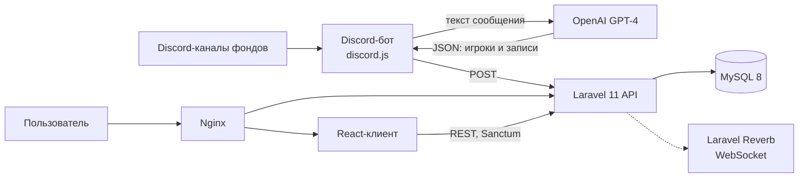

# Player's Reputation

Веб-платформа для покерных бэкеров (фондов), на которой они проверяют игроков по общей базе репутации, отправляют отчёты о нарушениях и ведут записи об игроках. Состоит из Laravel API, React-клиента и Discord-бота, который собирает данные из каналов фондов с помощью GPT-4.

Проект разработан по заказу и работает в продакшене.

## О вкладе

* **[illiaDubr](https://github.com/illiaDubr)** — бэкенд на Laravel (API, аутентификация и роли, схема БД и миграции, события и уведомления, импорт данных), Discord-бот на Node.js с разбором сообщений через OpenAI, Docker/Nginx и развёртывание.
* **[Maniken228](https://github.com/Maniken228)** — клиентская часть на React (`frontend/`).

> Реальные данные об игроках, дампы БД и рабочие конфигурации в репозиторий не входят: история очищена, для запуска есть `.env.example` в каждой части проекта.

## Что умеет система

**Поиск игроков**
* Открытый поиск с лимитом 30 запросов в сутки с одного IP: сопоставляет введённые данные с базой по именам, контактам и никам в покер-румах (около двух десятков полей) и считает, сколько полей совпало.
* Поиск для бэкеров (авторизованных): результаты с записями репутации (фонд, комментарий, ущерб, возмещение, источник), счётчик запросов по каждому фонду, базовый и расширенный режимы на клиенте.

**Репутация и модерация**
* Записи репутации привязаны к игроку и фонду; у игрока есть метка бэкера (`arbitration`, `left poker`, `pays off debt`, `closed issue`, `no tag`).
* Бэкеры отправляют отчёты об игроках, администраторы получают уведомления и обрабатывают их (список, редактирование, смена статуса, удаление проверенных отчётов).
* Правки данных игроков сохраняются в журнале изменений (`old_data` / `new_data`); администратор может просмотреть изменение, сменить его статус или откатить.
* Новые бэкеры проходят модерацию (список неподтверждённых и подтверждённых, смена статуса, редактирование данных фонда).

**Администрирование**
* Уведомления администраторов, список изменений и отчётов, выгрузка и загрузка резервной копии БД.

**Импорт данных**
* Discord-бот слушает настроенные каналы, отправляет текст сообщения и роль автора (название фонда) в GPT-4, получает структурированный JSON (игроки и записи репутации) и передаёт его в API.
* Скрипты бота выгружают историю каналов и обрабатывают её пачками; на стороне Laravel есть artisan-команды импорта (`ImportPlayerData`, `ImportFundsData`, `ImportArbHistory`, `ImportArbitrages`, пошаговая обработка JSON/NDJSON).

**Клиентская часть**
* Три раздела: публичный портал (описание ролей, обучающее видео, форма обратной связи), платформа бэкера (главная, поиск, профиль) и админ-панель.
* Вход через модальное окно, переключатель ролей, архитектура Feature-Sliced Design.

## Архитектура



Бэкенд транслирует события (`NewBackerForModeration`, `AdminNotify` и др.) через Laravel Reverb; подписка на WebSocket на стороне React в этом репозитории не подключена.

## Роли

| Роль | Доступ |
|---|---|
| `user` | Регистрация, вход, публичный поиск |
| `backer` | Поиск с записями репутации, отправка отчётов, данные своего фонда, метки игроков |
| `admin` / `superadmin` | Модерация бэкеров, отчёты, журнал изменений и откат, уведомления, резервные копии |

## Стек

| Часть | Технологии |
|---|---|
| Backend | PHP 8.2, Laravel 11, Sanctum, Reverb, L5-Swagger, openai-php/client, MySQL 8, Pest |
| Frontend | React 18, Vite 6, MobX, React Router 7, Axios, React Hook Form + Yup, SCSS-модули, GSAP, React Spring, Storybook 9, Vitest |
| Discord-бот | Node.js, discord.js 14, OpenAI SDK, Axios |
| Инфраструктура | Docker Compose (PHP-FPM, MySQL, Reverb, Nginx, сборка клиента) |

## Структура репозитория

```
player-reputation/
├── backend/        # Laravel: контроллеры, модели, события, artisan-команды, миграции, тесты
├── frontend/       # React (FSD: app, pages, widgets, features, shared)
├── discord-bot/    # Бот и скрипты выгрузки/разбора истории каналов
├── docker-compose.yml
└── nginx.conf
```

## Запуск локально

1. Скопируйте файлы окружения и заполните значения:
   ```bash
   cp backend/.env.example backend/.env
   cp frontend/.env.example frontend/.env
   cp discord-bot/.env.example discord-bot/.env
   ```
   В `backend/.env` задайте `SEED_ADMIN_PASSWORD`, `REVERB_APP_ID`, `REVERB_APP_KEY`, `REVERB_APP_SECRET`.

2. Поднимите сервисы (пароли БД в `docker-compose.yml` — только для локальной разработки):
   ```bash
   docker-compose up --build -d
   ```

3. Установите зависимости и подготовьте базу внутри контейнера backend:
   ```bash
   docker-compose exec backend composer install
   docker-compose exec backend php artisan key:generate
   docker-compose exec backend php artisan migrate --seed
   ```

4. Откройте приложение: http://localhost:8055 (API — `/api`, WebSocket Reverb — `ws://localhost:6001`).

Discord-бот в `docker-compose.yml` не входит. Запуск отдельно, после заполнения `discord-bot/.env`:
```bash
cd discord-bot
npm install
node index.js
```

Очередь уведомлений использует драйвер `database` (`QUEUE_CONNECTION=database`), для обработки фоновых заданий нужен `php artisan queue:work`.

## API

Основные группы маршрутов (`backend/routes/api.php`):

| Группа | Маршруты |
|---|---|
| Аутентификация | `POST /register`, `/login`, `/logout`, `/forgot-password`, `/reset-password`, подтверждение email |
| Поиск | `POST /search-player` (открытый, с лимитом), `POST /search-players` (для бэкеров) |
| Игроки | `PUT /players/{id}`, `PATCH /players/{id}/reputation/{recordId}`, `PATCH /players/{id}/backer-tag`, `POST /playerAdd` |
| Бэкеры | `GET /backers/approved`, `/backers/unapproved`, `PATCH /backers/{id}/status`, `PUT /backers/{id}`, `PATCH /backers/{id}/fund-info` |
| Отчёты | `POST /reports`, `GET /reports`, `PATCH /reports/{id}/status`, `DELETE /reports/{id}` |
| Изменения | `GET /changes`, `PATCH /changes/{id}`, `POST /changes/{id}/rollback` |
| Администрирование | `GET /admin/notifications`, `GET /backup/download`, `POST /backup/upload` |
| Импорт и статистика | `POST /messages`, `POST /process-json`, `GET /stats/search-players` |

Swagger-аннотации (L5-Swagger) добавлены только в части контроллеров, поэтому автоматическая документация неполная.

## Тесты и состояние проекта

* Backend (Pest): тесты аутентификации — вход, выход, регистрация, сброс пароля, подтверждение email. Бизнес-логика (поиск, отчёты, откат изменений) тестами пока не покрыта.
* Frontend: Vitest подключён, но тестов и скрипта запуска пока нет; для компонентов есть истории Storybook (`npm run storybook`).
* Лицензия не указана: код опубликован для демонстрации.
